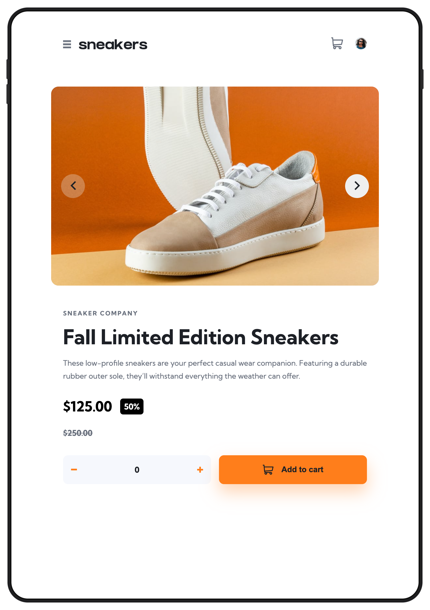
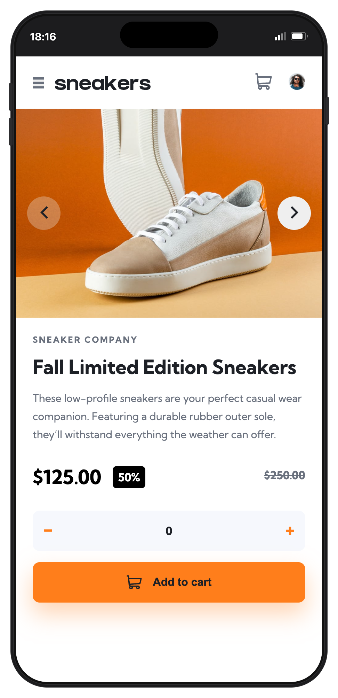

# Frontend Mentor - E-commerce product page solution

This is a solution to the [E-commerce product page challenge on Frontend Mentor](https://www.frontendmentor.io/challenges/ecommerce-product-page-UPsZ9MJp6). Frontend Mentor challenges help you improve your coding skills by building realistic projects.

## Table of contents

- [Overview](#overview)
  - [The challenge](#the-challenge)
  - [Screenshot](#screenshot)
  - [Links](#links)
- [My process](#my-process)
  - [Built with](#built-with)
  - [What I learned](#what-i-learned)
  - [Continued development](#continued-development)
  - [Useful resources](#useful-resources)
  - [AI Collaboration](#ai-collaboration)
- [Author](#author)
- [Acknowledgments](#acknowledgments)

## Overview

### The challenge

Users should be able to:

- View the optimal layout for the site depending on their device's screen size
- See hover states for all interactive elements on the page
- Open a lightbox gallery by clicking on the large product image
- Switch the large product image by clicking on the small thumbnail images
- Add items to the cart
- View the cart and remove items from it

### Screenshot


#### Mobile Devices

<div style="display: flex; gap:1rem">


</div>

### Links

- Solution URL: [Add solution URL here](https://your-solution-url.com)
- Live Site URL: [Add live site URL here](https://your-live-site-url.com)

## My process

### Built with

- Semantic HTML5 markup
- CSS custom properties
- Flexbox
- Mobile-first workflow
- JavaScript

### What I learned

I learned how to implement and image carousel using just css.

```css
.image-carousel-container {
  display: flex;
  anchor-name: --image-carousel;
  flex-direction: row;
  margin-block-end: 1.5rem;
  background-color: #c3cad9;
  width: 100%;
  height: 18.75rem;
  overflow-x: scroll;
  overflow-y: hidden;
  scroll-behavior: smooth;
  scroll-snap-type: x mandatory;
  scrollbar-width: none;
  list-style: none;
}

.image-carousel-container::-webkit-scrollbar {
  display: none;
}

.image-carousel-container::scroll-button(*) {
  position: absolute;
  position-anchor: --image-carousel;
  top: anchor(center);
  translate: 0 -50%;
  cursor: pointer;
  border: none;
  border-radius: 50%;
  padding: 0.5rem;
  width: 3rem;
  height: 3rem;
}

.image-carousel-container::scroll-button(left) {
  left: calc(anchor(right) - 100% + 1rem);
  content: url(./images/icon-previous.svg);
}
.image-carousel-container::scroll-button(right) {
  right: calc(anchor(left) - 100% + 1rem);
  content: url(./images/icon-next.svg);
}

.carousel-item {
  flex: 0 0 100%;
  height: 100%;
  scroll-snap-align: center;
}

.carousel-image {
  width: 100%;
  height: 100%;
  object-fit: cover;
}
```

### Continued development

Use this section to outline areas that you want to continue focusing on in future projects. These could be concepts you're still not completely comfortable with or techniques you found useful that you want to refine and perfect.

**Note: Delete this note and the content within this section and replace with your own plans for continued development.**

### Useful resources

- [MDN Docs](https://developer.mozilla.org/en-US/docs/Web/CSS/Guides/Overflow/Carousels) - This helped my understand the structure of a CSS image carousel.

### AI Collaboration

I did use Co-Pilot within VS Code, largely to help when i hit a stumbling block, my method was to try first using the documentation, then if I was still stuck ask for further help.

I do find it useful for those simple mistakes that can be made with typos when things are not working as they should.

## Author

- Website - [Add your name here](https://www.your-site.com)
- Frontend Mentor - [@yourusername](https://www.frontendmentor.io/profile/yourusername)
- Twitter - [@yourusername](https://www.twitter.com/yourusername)

**Note: Delete this note and add/remove/edit lines above based on what links you'd like to share.**

## Acknowledgments

This is where you can give a hat tip to anyone who helped you out on this project. Perhaps you worked in a team or got some inspiration from someone else's solution. This is the perfect place to give them some credit.

**Note: Delete this note and edit this section's content as necessary. If you completed this challenge by yourself, feel free to delete this section entirely.**
