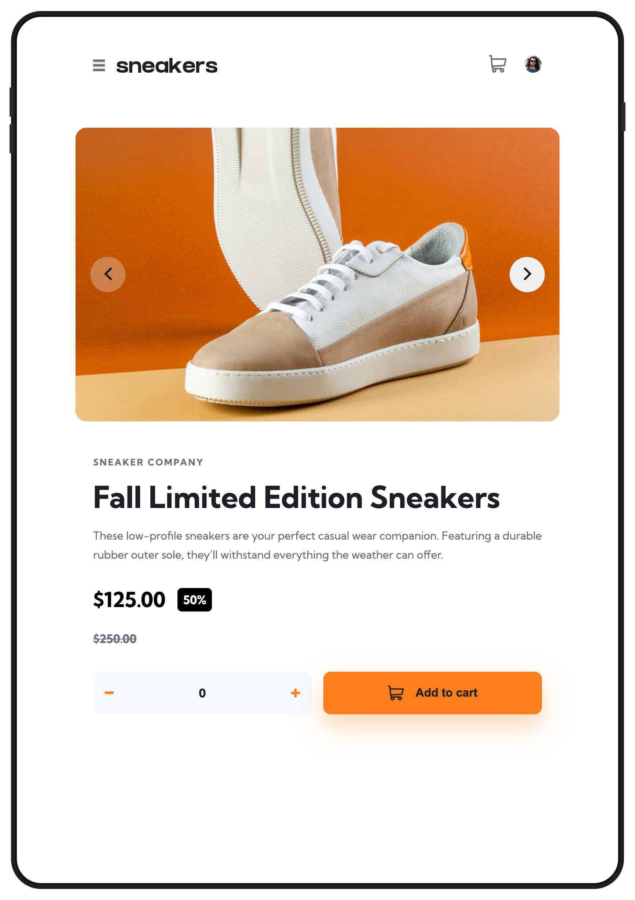
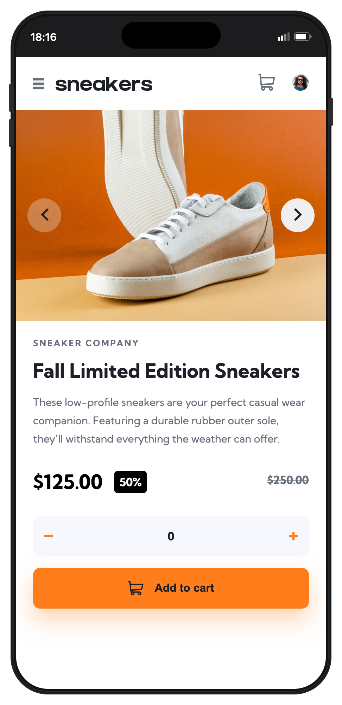

# Frontend Mentor - E-commerce product page solution

This is a solution to the [E-commerce product page challenge on Frontend Mentor](https://www.frontendmentor.io/challenges/ecommerce-product-page-UPsZ9MJp6). Frontend Mentor challenges help you improve your coding skills by building realistic projects.

## Table of contents

- [Overview](#overview)
  - [The challenge](#the-challenge)
  - [Screenshot](#screenshot)
  - [Links](#links)
- [My process](#my-process)
  - [Built with](#built-with)
  - [What I learned](#what-i-learned)
  - [Continued development](#continued-development)
  - [Useful resources](#useful-resources)
  - [AI Collaboration](#ai-collaboration)
- [Author](#author)
- [Acknowledgments](#acknowledgments)

## Overview

### The challenge

Users should be able to:

- View the optimal layout for the site depending on their device's screen size
- See hover states for all interactive elements on the page
- Open a lightbox gallery by clicking on the large product image
- Switch the large product image by clicking on the small thumbnail images
- Add items to the cart
- View the cart and remove items from it

### Screenshot

%20(1).png>)

#### Mobile Devices

<div style="display: flex; gap:1rem">


</div>

### Links

- GitHub Repo: [E-Commerce Product Page](https://github.com/jonmc89/ecommerce-product-page-main)
- Live Site URL: [Demo](https://jonmc89.github.io/ecommerce-product-page-main/)

## My process

### Built with

- Semantic HTML5 markup
- CSS custom properties
- Flexbox
- Mobile-first workflow
- JavaScript

### What I learned

I learned how to implement and image carousel using just css.

```css
.image-carousel-container {
  display: flex;
  anchor-name: --image-carousel;
  flex-direction: row;
  margin-block-end: 1.5rem;
  background-color: #c3cad9;
  width: 100%;
  height: 18.75rem;
  overflow-x: scroll;
  overflow-y: hidden;
  scroll-behavior: smooth;
  scroll-snap-type: x mandatory;
  scrollbar-width: none;
  list-style: none;
}

.image-carousel-container::-webkit-scrollbar {
  display: none;
}

.image-carousel-container::scroll-button(*) {
  position: absolute;
  position-anchor: --image-carousel;
  top: anchor(center);
  translate: 0 -50%;
  cursor: pointer;
  border: none;
  border-radius: 50%;
  padding: 0.5rem;
  width: 3rem;
  height: 3rem;
}

.image-carousel-container::scroll-button(left) {
  left: calc(anchor(right) - 100% + 1rem);
  content: url(./images/icon-previous.svg);
}
.image-carousel-container::scroll-button(right) {
  right: calc(anchor(left) - 100% + 1rem);
  content: url(./images/icon-next.svg);
}

.carousel-item {
  flex: 0 0 100%;
  height: 100%;
  scroll-snap-align: center;
}

.carousel-image {
  width: 100%;
  height: 100%;
  object-fit: cover;
}
```

Learning how to close the pop up menu's when the rest of the screen is access.

```js
// Clickable areas

document.addEventListener('click', (event) => {
  // Close cart when clicking outside
  if (!cartEl.contains(event.target) && !cartIconEl.contains(event.target)) {
    cartEl.classList.remove('cart-visible');
    cartEl.inert = true;

    cartIconEl.setAttribute('aria-expanded', 'false');
    cartIconEl.setAttribute('aria-label', 'Open cart menu');
  }

  // Close mobile menu when clicking outside
  if (
    !mobileMenuEl.contains(event.target) &&
    !mobileMenuBtnEl.contains(event.target)
  ) {
    mobileMenuEl.classList.remove('mobile-menu-open');
    mobileMenuEl.inert = true;

    mobileMenuBtnEl.setAttribute('aria-expanded', 'false');
    mobileMenuBtnEl.setAttribute('aria-label', 'Open navigation menu');

    mobileMenuBtnEl.classList.remove('menu-button-icon-close');
    overlayEl.classList.remove('overlay-show');
  }
});
```

### Continued development

N/A

### Useful resources

- [MDN Docs](https://developer.mozilla.org/en-US/docs/Web/CSS/Guides/Overflow/Carousels) - This helped my understand the structure of a CSS image carousel.

### AI Collaboration

I did use Co-Pilot within VS Code, largely to help when i hit a stumbling block, my method was to try first using the documentation, then if I was still stuck ask for further help.

I do find it useful for those simple mistakes that can be made with typos when things are not working as they should.

## Author

- Website - [jonmckenziewebdev.co.uk](https://jonmckenziewebdev.co.uk)
- Frontend Mentor - [@jonmc89](https://www.frontendmentor.io/profile/jonmc89)
- GitHub - [@jonmc89](https://github.com/jonmc89)

## Acknowledgments

N/A
